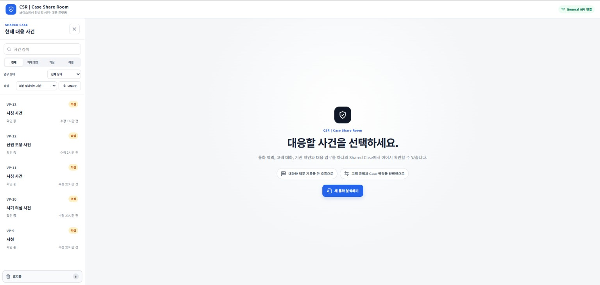
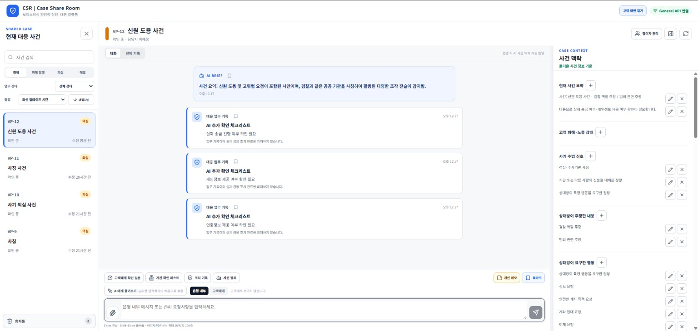
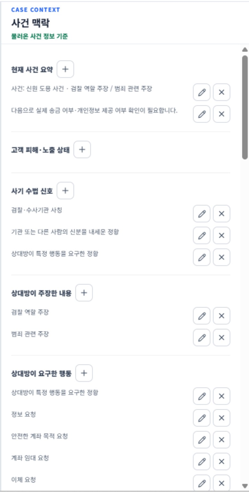
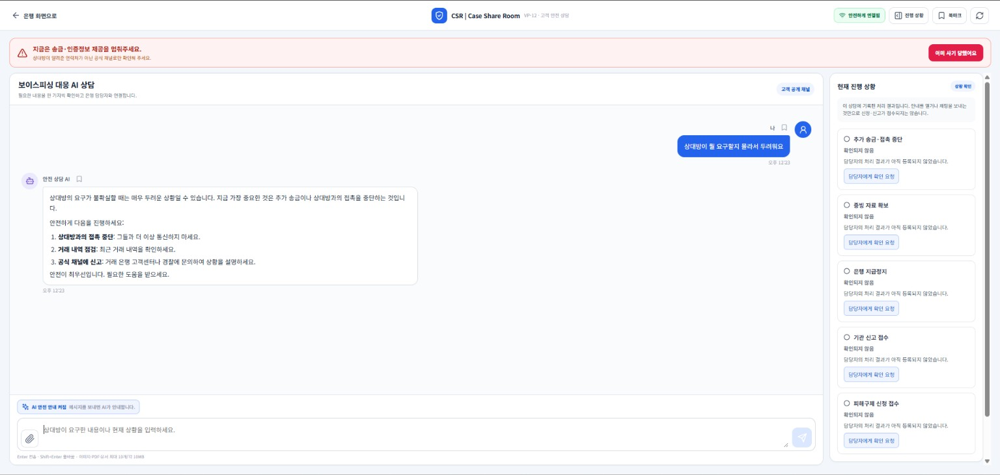
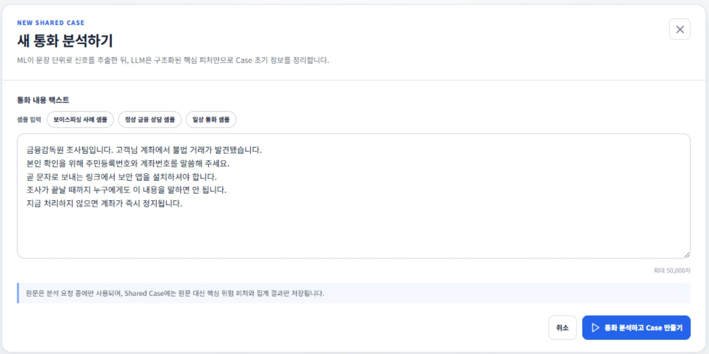
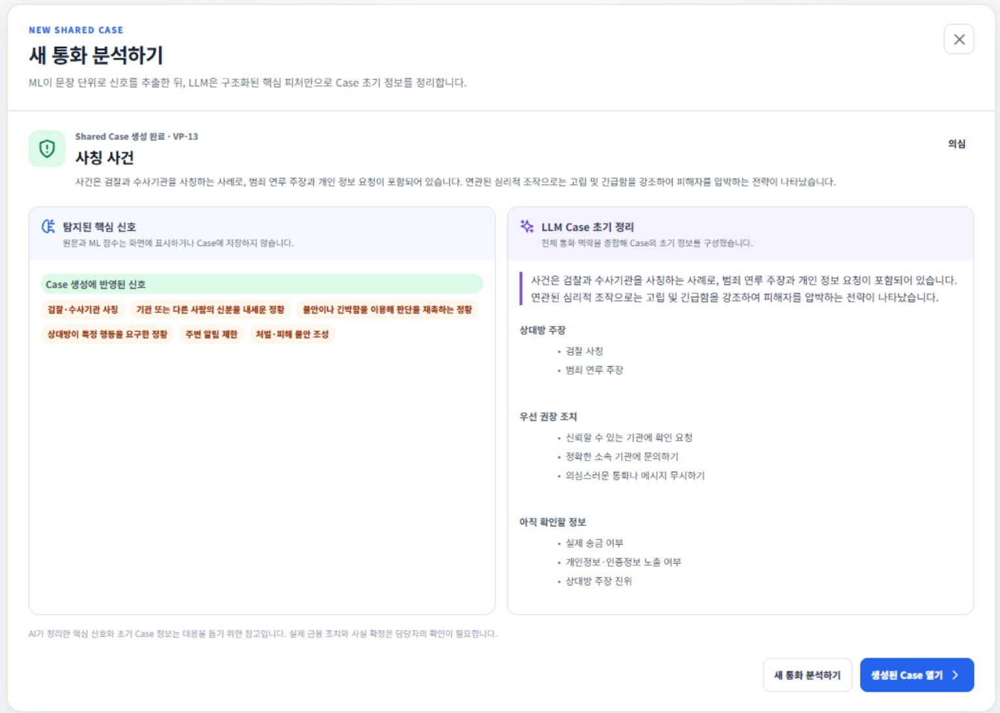
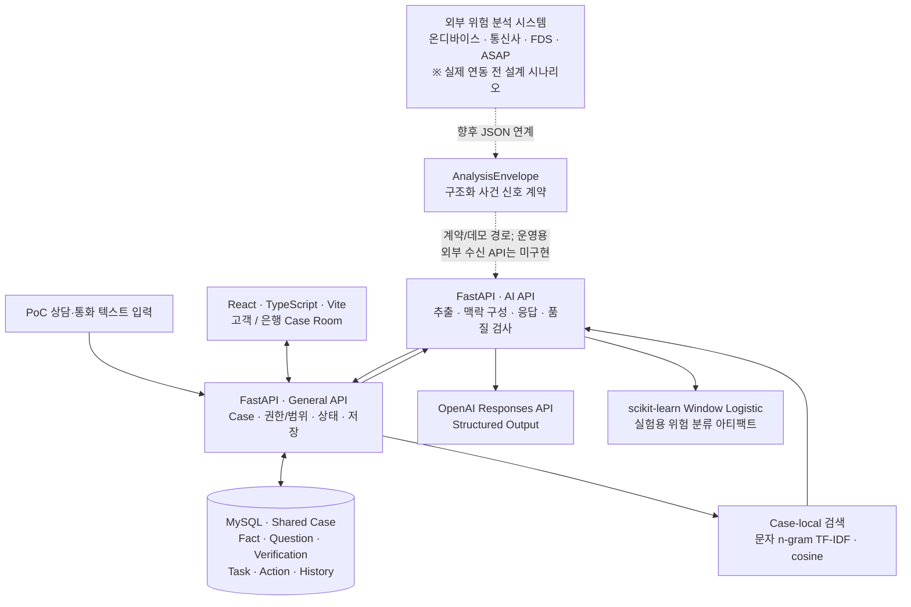

# CSR | Case Share Room

### 보이스피싱 **탐지 이후**, 사건 맥락과 대응을 연결하는 AI 업무 워크스페이스

> **AI가 사건 정보를 구조화하고, 은행 담당자와 고객이 같은 Case를 바탕으로 확인·질문·대응·기록을 이어가도록 설계한 팀 프로젝트 PoC**
>
> **2026.08–09 · 팀 프로젝트(3인) · 팀장 / AI 서비스 기획·Frontend·서비스 통합·품질 검증**

[](MVP_v3/frontend/)
[](MVP_v3/backend/)
[](MVP_v3/backend/ai_api/)
[](MVP_v3/database/)
[](MVP_v3/README.md)

**[📖 상세 Notion 포트폴리오](https://app.notion.com/p/e9ac753ff28a82cfa92a81ef1abcccd0)** · **[💻 MVP 실행 안내](MVP_v3/README.md)** · **[🛠 보관된 기술·역할별 구현 근거](https://github.com/hamhj7694/AIXTeamProject2/blob/b297c2fa430d517908430e14e167d14c87ad8f53/MVP_v3/docs/README.md)** · **[📚 보관된 구현 상태·개발 기록](https://github.com/hamhj7694/AIXTeamProject2/blob/b297c2fa430d517908430e14e167d14c87ad8f53/MVP_v3/docs/CURRENT_STATUS.md)**

> [!IMPORTANT]
> 본 저장소는 **금융기관 운영 환경에 적용된 상용 제품이 아닌 PoC**입니다. 온디바이스·통신사·FDS·ASAP 연동은 **설계 시나리오**이며 실제 기관 API 연동이 아닙니다. 아래 화면은 시연용 데이터와 개발 환경을 기반으로 합니다.

---

## 01. 서비스 미리보기

**탐지된 위험 신호만으로는 은행 직원이 '무슨 일이 있었고, 고객이 실제로 무엇을 했으며, 지금 무엇을 확인해야 하는지'를 바로 알기 어렵다**는 문제에서 시작했습니다.

| 사건 목록·상태 관리 | 은행 담당자 Case Room |
|:--:|:--:|
|  |  |
| **사건 상태, 최근 변경, 담당자 업무 접근** | **같은 사건의 대화·분석·확인·조치** |

| 현재 사건 맥락·근거 패널 | 고객 질문·상담 |
|:--:|:--:|
|  |  |
| **요구·실행·미확인·근거·업무 상태 구분** | **고객 공개 범위에 맞는 질문·답변·안내** |

<details>
<summary>다른 시연 화면 보기 — 새 사건 분석 / 분석 결과</summary>

| 새 분석 | 분석 결과 |
|:--:|:--:|
|  |  |

</details>

## 02. 문제 정의 → 해결 접근

| 발견한 문제 | CSR의 해결 방식 |
|---|---|
| 위험 탐지 이후 **사칭 주장·행동 요구·고객의 실제 행동**이 한 번에 파악되지 않음 | 발화를 Event·Semantic Atom·Fact·Context로 구조화하고 근거를 연결 |
| **송금 요구**와 **실제 송금**, **부인·정정**이 혼동될 수 있음 | 요구 / 실행 / 부인 / 미확인 / 확인 기록을 구분하고 상태와 출처 유지 |
| 고객 답변·직원 확인·기관 검증·업무 기록이 분산됨 | 하나의 **Shared Case**에 질문·Verification·Task·Action·History 축적 |
| AI가 미확인 사실을 확정하거나 조치 완료를 주장할 위험 | Schema·근거·상태·공개 범위 검증 및 **Human-in-the-Loop** 적용 |

**핵심 방향은 '보이스피싱을 새로 탐지하는 AI'를 만드는 것만이 아니라, 탐지 이후 사람이 안전하게 확인·대응하는 구간을 지원하는 것입니다.**

## 03. 사용자 관점의 핵심 흐름

1. **사건 접수·분석** — 시연 환경에서 상담·통화 텍스트 등을 받아 위험 신호와 사건 맥락을 분석합니다.
2. **Shared Case 생성** — 사칭, 요구 행동, 금액, 피해·노출, 출처, 미확인 사항을 사건별로 축적합니다.
3. **은행 담당자 확인** — CaseCopilot과 사건 패널에서 현재 상황·확인 필요 항목·근거를 조회합니다.
4. **고객 소통** — 확인 질문을 전달하고 고객 답변을 사건 기록에 연결합니다.
5. **검증·조치·인계** — 담당자가 Verification·Task·Action의 상태를 검토·기록하고 보고서로 정리합니다.

**AI의 제안이나 기록은 실제 계좌 지급정지·송금 조회·기관 연락이 완료되었다는 뜻이 아닙니다.** 금융 업무의 최종 판단과 외부 조치는 담당자 및 기존 금융 시스템의 책임으로 남겨 두었습니다.

## 04. 아키텍처 — 실제 PoC와 외부 연계 설계 구분



**데이터 흐름에서 지킨 경계**

- **Frontend → General API → AI API**: 프론트엔드가 내부 AI API를 직접 호출하지 않습니다.
- **General API**: Case와 사용자에게 허용된 정보 범위를 조립·검증하고 MySQL에 저장합니다.
- **AI API**: 구조화된 분석 결과·제안을 반환합니다. AI API가 금융업무 원장에 직접 조치를 확정하지 않습니다.
- **외부 연계**: 원문·녹음 대신 구조화 JSON을 수신하는 목표 구조를 설계했지만, **실제 금융기관의 데이터 수신과 연동은 미구현**입니다. 현재 시연 입력 경로와 동일시하지 않습니다.

자세한 실제 데이터 계약: **[온디바이스 분석 정보 인계 문서](https://github.com/hamhj7694/AIXTeamProject2/blob/b297c2fa430d517908430e14e167d14c87ad8f53/MVP_v3/docs/36_ON_DEVICE_ANALYSIS_DATA_HANDOFF.md)** · **[시스템 기술 스택](https://github.com/hamhj7694/AIXTeamProject2/blob/b297c2fa430d517908430e14e167d14c87ad8f53/MVP_v3/docs/README.md)**

## 05. 주요 AI·데이터 구현

### 5-1. LLM 기반 사건 정보 구조화

**OpenAI Responses API + JSON Schema + Pydantic**을 이용해 비정형 발화에서 사건 정보를 추출하고 정해진 데이터 계약으로 검증합니다.

```text
발화 / 시연 입력
    ↓
Event · Semantic Atom (누가, 무엇을 주장·요구·실행했는가)
    ↓
Context · Fact (상황 재구성, 상태 및 미확인 사항)
    ↓
source · evidence · status 연결
    ↓
Shared Case → 직원 검토 · 고객 질문 · 업무 카드
```

예를 들어 **"검찰이라며 500만 원을 보내라고 했다"**는 *기관 사칭 주장 + 송금 요구 + 요구 금액*이며, **실제 500만 원 송금 완료**로 확정하면 안 됩니다. 고객이 **"보내지 않았다"**고 말하면 별도의 부인·미수행 진술로 보존합니다.

관련 코드: [Event/Context 추출기](MVP_v3/backend/ai_api/app/domains/diagnosis/extractor.py) · [공통 진단 계약](MVP_v3/backend/contracts/diagnosis.py) · [사건 맥락 구현](MVP_v3/backend/general_api/app/domains/cases/context_v3/)

### 5-2. 위험 신호와 ML의 역할 분리

- **LLM/추출 계층:** 사칭·요구·압박·금전 등 사건 신호를 구조화
- **Feature Builder:** 최근 **10개 발화 Window**에서 신호의 존재·반복·다양성·결합 등을 수치 특징으로 집계
- **Window Logistic:** scikit-learn 기반 실험용 모델 파일로 위험 점수 추론; 임계값·가드레일 적용
- **담당자:** 모델 위험 점수와 사건 근거를 참고하되, 실제 조치 판단은 별도로 수행

이 저장소에 연결된 모델은 **`WINDOW_LOGISTIC_DASHBOARD_EXPERIMENTAL_SAMPLE_v1.pkl`**입니다. **별도 보이스피싱 ML 프로젝트에서 선택한 최종 Random Forest 모델과 동일한 아티팩트가 아닙니다.**

근거: [ML Adapter](MVP_v3/backend/ai_api/app/domains/diagnosis/model_adapter.py) · [모델 상태](MVP_v3/backend/ai_api/models/README.md) · [별도 ML 프로젝트](https://github.com/hamhj7694/AIXTeamProject1)

### 5-3. 사건 내부 검색과 역할별 AI

| 기능 | 실제 구현 방식 |
|---|---|
| **은행 CaseCopilot** | 최근 Fact·질문·검증·업무·대화·검색 출처를 근거로 대응 지원 |
| **Case-local Retrieval** | 사건 내부의 허용된 기록을 **문자 n-gram TF-IDF·cosine similarity**로 검색 |
| **고객 안전 안내** | 고객에게 공개 가능한 정보만 사용하도록 입력·출력 경계 분리 |
| **질문·업무 카드** | 미확인 상태를 바탕으로 질문/Verification/Task 초안 생성·직원 검토 |
| **Quality Guard** | 구조·근거·상태·허용 action 검사, 재생성 또는 검토 필요 상태 처리 |
| **종결 보고서** | Case 기록을 바탕으로 보고서 초안 생성 및 문서 출력 |

> **구현 범위:** Case 내부 검색은 외부 임베딩·Vector DB가 아닌 TF-IDF 기반 **lexical retrieval**입니다. 여러 AI 기능/역할이 존재하지만 별개의 파운데이션 모델을 직접 학습한 것은 아닙니다. 일부 Fact 추출·질문 로직은 LLM이 아닌 규칙 기반으로 동작합니다.

관련 코드: [Case 내부 검색](MVP_v3/backend/general_api/app/domains/cases/case_retrieval.py) · [은행 Copilot](MVP_v3/backend/ai_api/app/domains/case_support/copilot_service.py) · [고객 안내](MVP_v3/backend/ai_api/app/domains/case_support/customer_support_service.py) · [보고서](MVP_v3/backend/ai_api/app/domains/case_support/final_report_service.py)

### 5-4. 화면과 데이터 계약의 일치

AI가 반환한 JSON을 그대로 출력하지 않고, 출처와 확인 상태를 업무 화면에 맞게 투영했습니다.

- **피해·노출:** 금전 / 개인정보 / 인증정보 / 기기 접근
- **확인·조치 진행:** 미완료·완료 항목과 담당 업무
- **주요 사기 정황:** 사칭·상황 주장·요구·압박
- **처리 기록:** 상담·확인·변경·조치 이력

각 항목에서 **요구받은 행동**, **고객이 실제로 했다고 진술한 행동**, **직원 확인 결과**, **미확인 상태**를 구별하도록 설계했습니다.

관련 코드: [Context 패널](MVP_v3/frontend/src/context-v3/ContextPanelV3.tsx) · [패널 데이터 투영](MVP_v3/backend/general_api/app/domains/cases/right_panel_projection.py)

## 06. 기술 스택

| 영역 | 기술 | 실제 역할 |
|---|---|---|
| Frontend | **React · TypeScript · Vite · React Router** | 은행·고객 Case Room, 채팅, 질문/업무 UI |
| Backend | **Python · FastAPI · Uvicorn · HTTPX** | General API / AI API 분리, 비동기 요청 |
| LLM | **OpenAI Responses API · JSON Schema · Pydantic** | 사건 분석·출력 구조화·Copilot·보고서 |
| ML | **scikit-learn · pandas · NumPy** | 실험용 Window Logistic 추론·특징 집계 |
| 검색 | **문자 n-gram TF-IDF · cosine similarity** | Case 내부 근거 검색(별도 Vector DB 사용하지 않음) |
| Data | **MySQL · aiomysql · SQL migrations** | 사건 상태·Fact·질문·검증·업무·이력 관리 |
| 음성 파일 | **OpenAI Audio Transcriptions API** | 파일 업로드 음성 전사 경로(실시간 통화 인식과 구분) |
| 실행·검증 | **Docker Compose · Nginx · pytest · Vitest · GitHub Actions** | 컨테이너 실행, 프록시, 회귀 테스트 |

AI 모델 ID는 환경변수로 교체할 수 있으며, 저장소의 예시 설정과 실제 실행·평가에 사용된 모델이 동일하다고 단정하지 않습니다. 자세한 모델/기능 연결은 [기술 스택 문서](https://github.com/hamhj7694/AIXTeamProject2/blob/b297c2fa430d517908430e14e167d14c87ad8f53/MVP_v3/docs/README.md)를 참고해 주세요.

## 07. 팀 구성과 나의 기여

**팀 프로젝트(3인) · 함형준 / 팀장**

| 영역 | 주요 기여 |
|---|---|
| **문제 정의·기획** | 탐지 이후 사건 이해·반복 확인·대응 지연을 문제로 설정하고 서비스 시나리오 설계 |
| **업무/화면 구조** | 은행·고객 역할별 흐름, Case Room·Context 패널·질문·업무 UX 설계 |
| **Frontend·통합** | React 화면 갱신, General API/AI 결과의 화면 투영, 기능 간 연결·통합 점검 |
| **AI 데이터 계약 협업** | Event·Fact·Context·Verification의 상태/근거와 화면 요구사항을 맞추는 과정 참여 |
| **품질 및 팀 리딩** | 역할·작업 의존성·인계 순서 조율, Git 협업, 사용자 흐름·오류 재검증, 문서·발표 정리 |

초기 역할은 **Backend·MySQL / AI·ML·LLM / Frontend·서비스 통합**으로 나누어 진행했고, 설계·계약 협의·테스트·통합은 팀이 함께 수행했습니다. **모든 AI/Backend 코드를 팀장 혼자 개발했다고 주장하지 않습니다.**

자세한 팀 단위 구현 및 역할 분담: **[구현 상태·개발 기록](https://github.com/hamhj7694/AIXTeamProject2/blob/b297c2fa430d517908430e14e167d14c87ad8f53/MVP_v3/docs/CURRENT_STATUS.md)**

## 08. 검증 결과 및 한계

### AI 보조 정답셋의 사용자 검수 및 최신 탐색 평가

**정답 라벨은 GPT가 1차 작성하고, 프로젝트 소유자가 원문과 대조해 검토·승인했다고 확인했습니다.**
이 검수 사실은 2026-10-16에 별도 기록으로 남겼습니다. 정답을 사람이 처음부터 직접 라벨링했다고 주장하지 않습니다.

| v3.1 핵심 사실 5종 존재 여부 평가 | 결과 |
|---|---:|
| 내부 평가 Case | **30건** (고유 대화 시퀀스 2개) |
| 정답 양성 / TP / FP / FN | 100 / **87** / **3** / **13** |
| Precision | **96.7%** |
| Recall | **87.0%** |
| F1 | **91.6%** |

이는 기존에 실제로 실행해 저장된 v3.1 결과를 대상으로 계산한 **5종 핵심 사실 존재 여부의 제한적 내부 평가**입니다. 송금 요구 탐지에서는 실제 양성 20개 중 13개를 놓쳤습니다. 과거 v3.0 보정 Gold의 Recall 14.0%는 판정 규칙이 달라 **87.0%와 직접 비교한 성능 개선율이 아닙니다.** 30개 Case에도 고유한 통화 시퀀스는 2개뿐이므로 일반화된 정확도를 의미하지 않습니다.

**평가 근거:** [사람 검수 확인 기록](MVP_v3/tests/context_test/run_comparison/HUMAN_REVIEW_ATTESTATION_20261016.json) · [비교·해석 보고서](MVP_v3/tests/context_test/run_comparison/AI_ASSISTED_QUALITY_SCORECARD_20261016.md) · [30건별 평가 수치](MVP_v3/tests/context_test/run_comparison/AI_ASSISTED_QUALITY_SCORECARD_20261016.json) · [재계산 코드](MVP_v3/tests/context_test/run_comparison/score_ai_assisted_reference.py)

> **평가 범위:** 이 검수 확인은 소유자 본인의 확인 기록으로, 외부 독립 전문가의 사례별 감사 결과는 아닙니다. 2026-09-16 VP-18 단일 샘플의 Event·Atom·Critical Slot Precision/Recall/F1은 당시 정답 미등록으로 **미산출**이었으며, 위의 5종 사실 점수가 해당 수치들을 대체하지는 않습니다.

### 후속 실험 별도 기록

[Notion 포트폴리오](https://app.notion.com/p/e9ac753ff28a82cfa92a81ef1abcccd0)에는 후속 내부 실험에서 다음 **관측치**가 기록되어 있습니다.

| 항목 | 초기 기록 | 후속 기록 |
|---|---:|---:|
| Critical Fact Recall | 31.37% | 61.0% |
| Context Feature Recall | 41.45% | 68.0% |
| Hallucination | 76건 | 18건 |
| 사실 모순 | 7건 | 2건 |

> [!CAUTION]
> **이 수치를 동일 조건에서 재현된 공식 모델 개선율이나 상용 환경 성능으로 해석하면 안 됩니다.** 현재 저장소의 공식 비교 자료에는 평가 조건·정답 투영 및 의미 점수화에서 미완료 항목이 남아 있습니다. 수치는 **Notion에 기록된 개발 단계 후속 관측치**이며, 동일 조건의 독립 재검증이 필요합니다.
> 근거: [공식 비교 상태 JSON](https://github.com/hamhj7694/AIXTeamProject2/blob/b297c2fa430d517908430e14e167d14c87ad8f53/MVP_v3/docs/now_md/A_part/A%ED%8C%8C%ED%8A%B8%20%ED%85%8C%EC%8A%A4%ED%8A%B8%20%EB%B0%8F%20%ED%8C%8C%EC%9D%B4%ED%94%84%EB%9D%BC%EC%9D%B8%20%EA%B5%AC%EC%A1%B0%20%EC%A0%95%EB%A6%AC/run_comparison/official_comparison_metrics.json) · [품질 보고서 예시](https://github.com/hamhj7694/AIXTeamProject2/blob/b297c2fa430d517908430e14e167d14c87ad8f53/MVP_v3/docs/now_md/A_part/A%ED%8C%8C%ED%8A%B8%20%ED%85%8C%EC%8A%A4%ED%8A%B8%20%EB%B0%8F%20%ED%8C%8C%EC%9D%B4%ED%94%84%EB%9D%BC%EC%9D%B8%20%EA%B5%AC%EC%A1%B0%20%EC%A0%95%EB%A6%AC/reports/sample-20260916/metrics/quality-metrics-report.md)

**외부 검토:** 「2026 AI·디지털 기반 사회문제 해결 챌린지」 **서류심사 통과** (수상이나 금융기관 도입을 의미하지 않음).

### 상용화 이전에 필요한 작업

- 실제 외부 위험 탐지 시스템과의 구조화 데이터 **수신 API·연동·보안 검증**
- 운영 환경 수준의 **인증·인가·개인정보 보호·망분리**
- 금융기관 실제 데이터와 다양한 사건 유형을 대상으로 한 독립적 **정확성·편향·안전성 평가**
- 운영 모니터링·장애 대응·권한 감사·데이터 보존 정책 검증

## 09. 실행 및 저장소 안내

실행 중심 폴더는 **`MVP_v3/`**입니다. 이전 버전·작업 문서와 구분해 주세요. 일부 과거 `docs/` 문서는 저장소 정리 과정에서 `main`에서 삭제되어 위 링크는 보관 커밋을 가리킵니다.

```text
MVP_v3/
├── frontend/             # React · TypeScript, Nginx 정적 배포
├── backend/
│   ├── general_api/      # Case·업무·DB·권한 및 공개 API
│   ├── ai_api/           # LLM 추출·Copilot·실험용 Window ML
│   ├── contracts/        # 공통 Pydantic 데이터 계약
│   ├── migrations/       # MySQL 스키마 변경 이력
│   └── scripts/          # DB·API 점검 도구
├── database/             # MySQL 초기 스키마
├── tests/context_test/   # 평가 이력과 AI 보조 정답·사람 검수 기록
├── docker-compose.yml
└── .env.example
```

로컬 개발 환경에서 실행하려면 OpenAI API 키와 MySQL 연결 정보 등 설정이 필요합니다. **운영 비밀키를 Git에 올리지 마세요.** Docker Compose 실행, 기존 DB migration, 개별 API 실행 및 검증 방법은 아래 원본 문서에서 확인할 수 있습니다.

- [MVP_v3 설치·실행](MVP_v3/README.md)
- [Backend 환경 설정과 API 실행](MVP_v3/backend/README.md)
- [현재 구현 상태와 미완료 항목](https://github.com/hamhj7694/AIXTeamProject2/blob/b297c2fa430d517908430e14e167d14c87ad8f53/MVP_v3/docs/CURRENT_STATUS.md)
- [전체 시스템 기술 스택](https://github.com/hamhj7694/AIXTeamProject2/blob/b297c2fa430d517908430e14e167d14c87ad8f53/MVP_v3/docs/README.md)

---

### 프로젝트를 통해 얻은 경험

**도메인 문제 정의 → AI 데이터 구조 설계 → LLM/ML 기능 연계 → API·DB·Frontend 통합 → 근거·상태 검증 → 사용자 업무 흐름 개선**

CSR은 단순히 AI가 위험을 설명하는 데서 끝나지 않고, **사람이 확인할 수 있는 사건 정보와 다음 업무를 연결하는 AI 애플리케이션**을 구현·검증한 프로젝트입니다.
